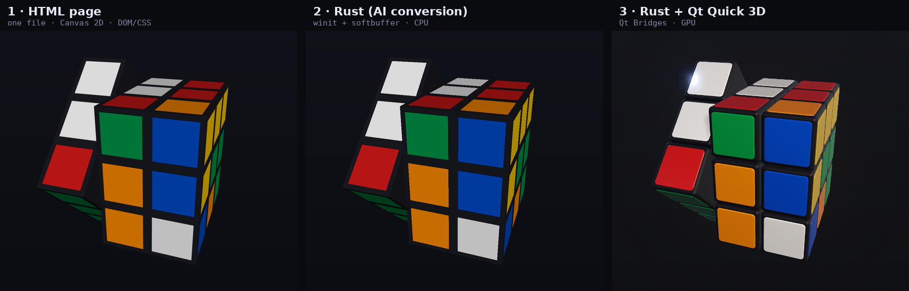
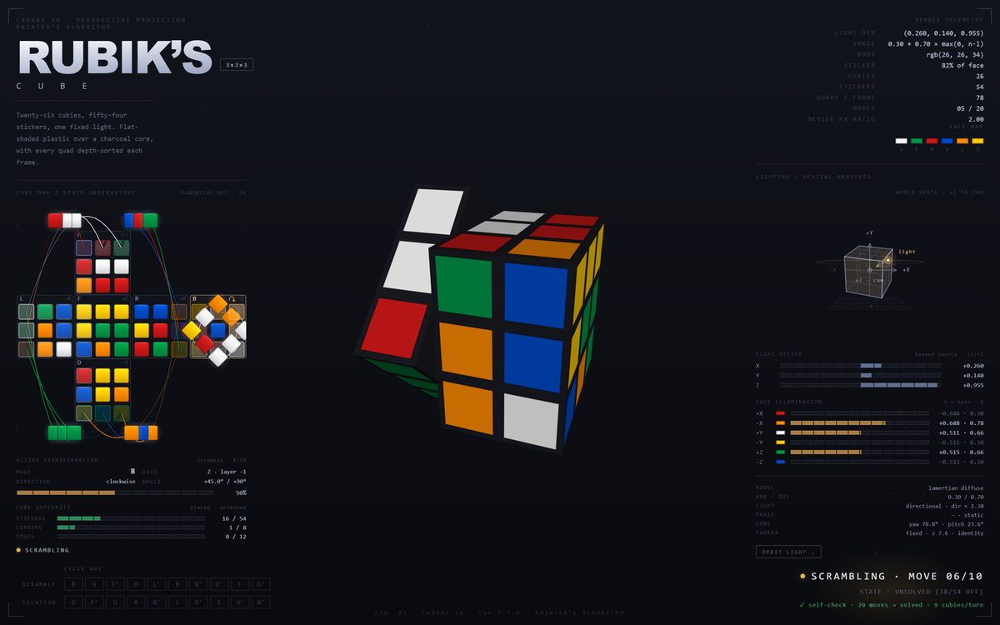
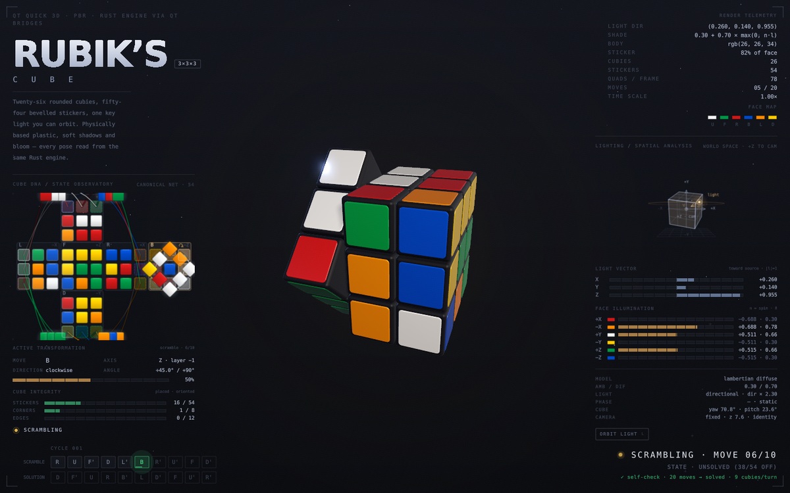
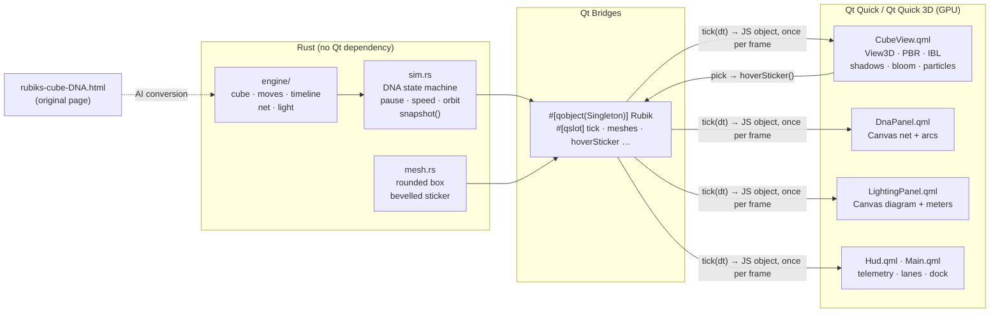

<div align="center">

# Rubik's Cube · HTML → Rust → Qt

**One Rubik's Cube visualisation in three forms: a single-file HTML page, an AI conversion
of that page to native Rust, and this repository, a Qt Quick 3D version of the Rust app
built on Qt Bridges.**


<sub>Live capture of the Qt version. The cube, the unfolded "DNA" net (left) and the lighting
instrument (right) are all driven by one Rust simulation, frame by frame.</sub>

</div>

---

## Contents

- [The journey: HTML → Rust → Qt](#the-journey-html--rust--qt)
- [Same moment, three renderers](#same-moment-three-renderers)
- [Why Qt? Eight things it gave this project](#why-qt-eight-things-it-gave-this-project)
- [Architecture](#architecture)
- [Features & controls](#features--controls)
- [Build & run](#build--run) · [Windows](#windows-11) · [Linux / WSL](#linux--wsl)
- [Engineering notes](#engineering-notes)
- [How this was built](#how-this-was-built)
- [The full write-up →](docs/WRITEUP.md)

---

## The journey: HTML → Rust → Qt

| | Stage | What it is | How it was made |
|---|---|---|---|
| **1** | **HTML page** | `rubiks-cube-DNA.html`: one self-contained 2,994-line file with no dependencies. Canvas 2D draws the cube; a responsive DOM/CSS HUD surrounds it; two more canvases hold a lighting instrument and a "cube DNA" instrument; self-tests are built in. | Grew over three iterations: the cube (970 lines), then the lighting panel (1,708), then the DNA panel (2,994) |
| **2** | **Native Rust** | The same page as a desktop program, with no browser. `winit` opens the window, `softbuffer` takes the pixels, and everything the browser used to provide is rebuilt in Rust: a Canvas 2D rasteriser, text rendering, and the CSS layout. | An **AI prompt converted the HTML to Rust**, followed by a profiling pass that took the Windows build from 9 to about 30 fps at 4K |
| **3** | **Rust + Qt** *(this repo)* | The Rust engine is kept as it is. The browser-replacement layer is retired, and Qt Quick and Qt Quick 3D do the presentation, connected to Rust through **[Qt Bridges](https://www.qt.io/development/qt-framework/qt-bridges/rust-gui)**. | **AI was asked to implement a Qt version**, following Qt's Qt Bridges tutorial |

The interesting step is the second one. Converting a web page to native code means losing
the browser, and the browser was doing a lot: drawing paths and gradients, laying out text,
applying CSS, compositing layers. The Rust conversion faithfully rebuilt all of that by
hand, which is why its presentation code alone is about **4,240 lines** around an
898-line puzzle engine.

**Qt gives those services back natively, plus a GPU 3D engine the HTML page never had.**
That's the core of this project's "after".

---

## Same moment, three renderers

All three versions share the same deterministic clock, so each can render an exact instant.
Here is t = 4.75 s, a quarter turn of the back face, half done:



The Rust conversion matches the HTML page almost pixel for pixel, which shows how faithful it
is. The Qt version shows the **identical state** (same pose, same slice angle, same
counters) rendered with rounded geometry, physically based materials, image-based lighting
and shadows.

<table>
<tr>
<th width="33%">1 · HTML page</th>
<th width="33%">2 · Rust conversion</th>
<th width="33%">3 · Rust + Qt</th>
</tr>
<tr>
<td></td>
<td></td>
<td></td>
</tr>
<tr>
<td>

- Canvas 2D, painter's algorithm
- DOM + CSS HUD with media queries
- Runs anywhere a browser does

</td>
<td>

- The same pixels, with no browser
- A hand-built Canvas 2D, text and CSS layout
- CPU rendering, 2× supersampled

</td>
<td>

- Rounded cubies, bevelled stickers
- PBR, HDR lighting, shadows, AO, bloom
- Orbit, zoom, 3D picking, exploded view

</td>
</tr>
</table>

#### By the numbers

| | 1 · HTML | 2 · Rust conversion | 3 · Rust + Qt |
|---|---|---|---|
| Size | 2,994 lines (HTML + CSS + JS, one file) | 898-line engine + **~4,240 lines** of presentation | the same 898-line engine + **~2,350 lines** (1,711 QML + Rust bridge/mesh) |
| Who draws the pixels | the browser | the app, on the CPU, pixel by pixel | Qt, on the GPU (D3D11 / Vulkan / OpenGL) |
| Text and layout | the browser (CSS) | hand-built (1,197-line rasteriser and font engine, ~560 lines of layout) | Qt Quick (QML anchors, `Text`) |
| 3D | flat quads, depth-sorted | flat quads, depth-sorted | meshes, PBR, IBL, shadows, AO, bloom, particles |
| App CPU per frame<sup>1</sup> | — | ~30 ms | **~2.3 ms** |
| Interaction | `L` key, net hover | `L` key, net hover | orbit, zoom, 3D pick, pause, time scale, explode, help |

<sub><sup>1</sup> Rust: the conversion's own Tracy profiling on Windows (4K at 250 %). Qt:
measured in-app (`--quit-after`) on the same laptop (RTX A5000). Different window sizes;
the point is where the work lives, not a benchmark. Line counts are non-blank.</sub>

| Hover any cubie: it glows and is named | Exploded view (`E`) | Verified solve |
|---|---|---|
|  |  |  |

---

## Why Qt? Eight things it gave this project

Each point links to the code that shows it.

### 1 · Rust stays Rust: Qt Bridges is a thin attribute layer

The whole Rust ↔ QML surface is one struct with attributes. No C++, no `moc` headers to
maintain, no FFI glue written by hand ([`src/main.rs#L28`](src/main.rs#L28)):

```rust
#[derive(Default)]
pub struct Rubik { sim: Sim }

#[qobject(Singleton)]
impl Rubik {
    /// Advance by `dt` seconds of wall time and return the frame snapshot.
    #[qslot]
    fn tick(&mut self, dt: f64) -> Value {          // serde_json::Value -> plain JS object
        self.sim.step(dt);
        self.sim.snapshot()
    }

    #[qslot(qml_name = "toggleOrbit")]
    fn toggle_orbit(&mut self) { /* ... */ }
}
```

```qml
import rubik_qt            // the Cargo package name *is* the QML module

FrameAnimation { onTriggered: win.f = Rubik.tick(frameTime) }
```

The simulation ([`src/sim.rs`](src/sim.rs)) has no Qt dependency at all, so 18 unit tests
run with plain `cargo test`.

### 2 · What the browser did, back as a native toolkit

Converting to Rust meant re-implementing Canvas 2D, text and CSS layout by hand
(about 1,750 lines). In the Qt version that code is simply **gone**. QML anchors and
`Text` lay out the HUD ([`Hud.qml`](src/qml/Hud.qml)), `Behavior` and `ColorAnimation`
replace CSS transitions, and `Window` + `FontLoader` handle high-DPI and fonts. The HUD
reads like the HTML page's markup again rather than like a rasteriser.

### 3 · A production 3D renderer in ~30 lines of configuration

Physically based rendering, HDR image-based lighting, filmic tone mapping, SSAO, MSAA,
specular anti-aliasing and multi-level bloom are **properties**, not projects
([`src/qml/CubeView.qml#L80-L106`](src/qml/CubeView.qml#L80-L106)):

```qml
environment: ExtendedSceneEnvironment {
    tonemapMode: SceneEnvironment.TonemapModeFilmic
    lightProbe: Texture { source: "studio.hdr"; mappingMode: Texture.LightProbe }
    antialiasingMode: SceneEnvironment.MSAA
    aoEnabled: true;   aoStrength: 55
    glowEnabled: true; glowHDRMinimumValue: 1.6
    specularAAEnabled: true
}
```

The HTML page drew flat quads sorted back to front, and so did the Rust conversion.
Its glow was a pre-blurred sprite, and its anti-aliasing meant rendering twice the size and
averaging down.

### 4 · Rust-generated geometry, straight to the GPU

The rounded cubie bodies and bevelled stickers are computed in Rust
([`src/mesh.rs#L72`](src/mesh.rs#L72)), with analytic normals and a winding test.
QML hands them to the GPU through `ProceduralMesh`
([`CubeView.qml#L38`](src/qml/CubeView.qml#L38)). There are no asset files to ship or
convert.

### 5 · Interaction that would have been weeks of work is a few lines

- **3D hover picking**: `View3D.pick()` returns the sticker under the mouse, and Rust maps
  it to its net cell ([`CubeView.qml#L331`](src/qml/CubeView.qml#L331),
  [`main.rs#L85`](src/main.rs#L85)).
- **Exploded view** with a spring: one `NumberAnimation` with `Easing.OutElastic`
  ([`Main.qml#L188`](src/qml/Main.qml#L188)).
- **Confetti in the six sticker colours**: `ParticleSystem3D` with gravity
  ([`CubeView.qml#L246`](src/qml/CubeView.qml#L246)).
- **Orbit with inertia**: the drag rotation is composed *into the engine's spin*, so the
  lighting instrument keeps describing exactly what you see.

### 6 · The instruments went home to their original API

QML's `Canvas` speaks the same Context2D API as the HTML page. The DNA net's permutation
arcs, travelling tiles and halos ([`DnaPanel.qml#L128`](src/qml/DnaPanel.qml#L128)) and
the lighting diagram ([`LightingPanel.qml#L48`](src/qml/LightingPanel.qml#L48)) are back
to `ctx.arc`, `createRadialGradient` and `setLineDash`, close to the page's own JavaScript.
In the Rust conversion, each of those calls had needed its own rasteriser routine.

### 7 · The scene graph *is* the state, and the frames are atomic

Each of the 26 cubies is a `Node` bound to the Rust snapshot
([`CubeView.qml#L148`](src/qml/CubeView.qml#L148)). The partial slice turn is composed in
Rust ([`sim.rs#L277`](src/sim.rs#L277)), and one snapshot per frame feeds the 3D view
and both instruments, so they can never show different moments. The HTML page got that
by drawing everything in one function. The Qt version keeps the guarantee.

### 8 · One binary, every backend, real platform polish

QML, fonts and the HDR environment are compiled into the executable
(`include_bytes_qml!`, [`main.rs#L251`](src/main.rs#L251)). Qt's RHI picks Direct3D 11
on Windows, Vulkan or OpenGL on Linux, and Metal on macOS. `windeployqt` produces a portable
folder ([`build-windows.ps1`](build-windows.ps1)). The window icon is one embedded
`IDI_ICON1` resource ([`build.rs`](build.rs), [`icon/rubik_qt.rc`](icon/rubik_qt.rc)),
and multi-monitor placement (`--screen N`) and high-DPI scaling come from Qt.

---

## Architecture



| Path | What lives there |
|---|---|
| [`src/engine/`](src/engine) | The puzzle, as converted from the page's JavaScript: 26 cubies, exact quarter-turn algebra, scramble/solve timeline, canonical net, lighting model. Carried over from the Rust conversion unchanged (one import line differs). |
| [`src/sim.rs`](src/sim.rs) | The DNA panel's state machine, the new controls, and `snapshot()`: one JSON object per frame describing everything on screen |
| [`src/mesh.rs`](src/mesh.rs) | Procedural geometry for Qt Quick 3D |
| [`src/main.rs`](src/main.rs) | The Qt Bridges singleton, CLI, and GPU selection on Windows and WSL |
| [`src/qml/`](src/qml) | The UI: `Main`, `CubeView` (3D), `Hud`, `DnaPanel`, `LightingPanel`, `Background`, small components |
| [`tests/`](tests) | The page's own `selfTest()` / `verifySequence()` checks, ported |
| [`tools/make_studio_hdr.py`](tools/make_studio_hdr.py) | Generates the HDR studio light probe (standard library only) |

---

## Features & controls

| Input | Effect |
|---|---|
| **drag** / wheel / double-click | orbit the cube (with inertia) / zoom / reset view |
| **hover a cubie** | it glows, a tooltip names it (face · row · col, home slot, corner/edge/centre, twist), and its sticker is ringed in the net |
| hover a square in the **CUBE DNA** net | the same inspection, the other way round |
| `Space` | pause / resume the clock |
| `+` / `-` | time scale 0.05× – 8× |
| `E` | exploded view |
| `L` or **ORBIT LIGHT** | orbit the key light: shading, shadows and the lighting panel follow |
| `R` | reset view |
| `Q` | post-processing quality (MSAA · SSAO · soft shadows) |
| `C` | fire the solve celebration |
| `F` | fullscreen |
| `H` / `?` | help overlay |
| `Esc` | close help / quit |

Every cycle ends with a verified solve, printed as `[cube] cycle 001 after solve sequence: SOLVED`,
the same line the HTML page logged to its console.

<details>
<summary><b>Command-line options</b></summary>

```
--width / --height <px>      window size (default 1440x900)
--screen <n>                 open on monitor n
--quality low                lighter post-processing (software GL)
--fullscreen
--shot out.png --at <secs>   render one frame at a clock reading, save it, quit
  --explode --hover <0-53> --celebrate --pointer-x/-y <px> --delay <ms>   capture helpers
--quit-after <secs>          run live, print fps + per-frame Rust/QML cost, then quit
--only-3d                    hide the 2D overlays (profiling)
```
</details>

---

## Build & run

**Requirements:** Rust ≥ 1.88 · a C++ compiler · **Qt ≥ 6.10** with `qtbase`,
`qtdeclarative`, `qtquick3d`, `qtshadertools` and `qtquicktimeline`. Qt Bridges finds Qt
through `qmake`: set `QMAKE`, or copy [`.cargo/config.toml.example`](.cargo/config.toml.example)
to `.cargo/config.toml`.

### Windows 11

You need Rust (MSVC), Visual Studio 2022 Build Tools, and Qt for MSVC 2022 x64. Then:

```powershell
powershell -ExecutionPolicy Bypass -File .\build-windows.ps1 -QtDir C:\Qt\6.12.1\msvc2022_64 -Run
```

This builds `dist\rubik_qt.exe` and bundles a portable folder with the Qt DLLs, QML
plugins and the MSVC runtime. On hybrid-graphics laptops the app selects the discrete
GPU itself. See [Engineering notes](#engineering-notes).

### Linux / WSL

```bash
export QMAKE=~/Qt/6.12.1/gcc_64/bin/qmake
cargo build --release
./target/release/rubik_qt
cargo test --release         # 18 tests: the page's self-checks, meshes, simulation
```

`build.rs` bakes Qt's library path into the binary, so `LD_LIBRARY_PATH` isn't needed.

---

## Engineering notes

A few things that weren't obvious, and how they were solved:

- **Hybrid GPUs pick the wrong adapter.** Qt's D3D11 backend uses DXGI adapter 0, which on
  Optimus laptops is the integrated Intel GPU. The app enumerates the adapters and
  selects the one with the most dedicated VRAM ([`main.rs#L187`](src/main.rs#L187)).
- **`std::env::set_var` is invisible to Qt on Windows.** Qt reads the C runtime's copy of
  the environment, so the value is also set with `_putenv_s`
  ([`main.rs#L215`](src/main.rs#L215)).
- **WSL silently falls back to CPU rendering** (Mesa's Zink driver fails). Selecting the
  `d3d12` Gallium driver and XWayland is a 10× speed-up, applied automatically
  ([`main.rs#L150`](src/main.rs#L150)).
- **A `Repeater` fed a per-frame array rebuilds its delegates every frame.** All per-frame
  data is indexed through fixed-count models instead.
- **CSS letter-spacing is measured in em.** The page's CSS `letter-spacing` maps to
  `font.letterSpacing = em × px` ([`Label2.qml`](src/qml/Label2.qml)).

---

## How this was built

This project is an experiment in **AI-assisted porting**, directed by the author:

1. The HTML page came first, built up over three iterations.
2. An AI coding assistant was prompted to convert that page to native Rust (stage 2).
3. An AI coding assistant was then asked to create a Qt version of the Rust app using
   Qt Bridges (stage 3), keeping the converted engine and adding the UI enhancements.

The [full write-up](docs/WRITEUP.md) tells the story step by step: what each stage
inherited, what Qt replaced, what went wrong, and what it cost.

---

<div align="center">
<sub>Built with Rust, <a href="https://www.qt.io/development/qt-framework/qt-bridges/rust-gui">Qt Bridge for Rust</a> (technology preview) and Qt 6.12.</sub>
</div>
