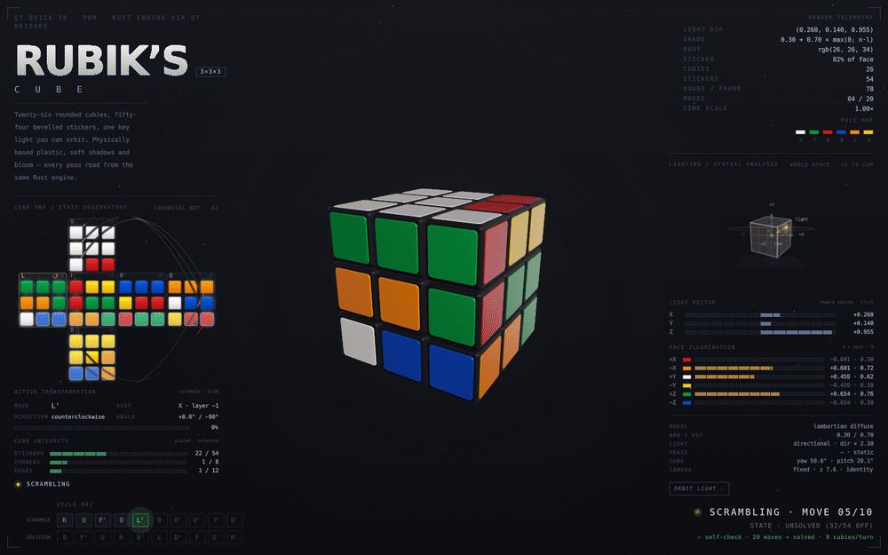
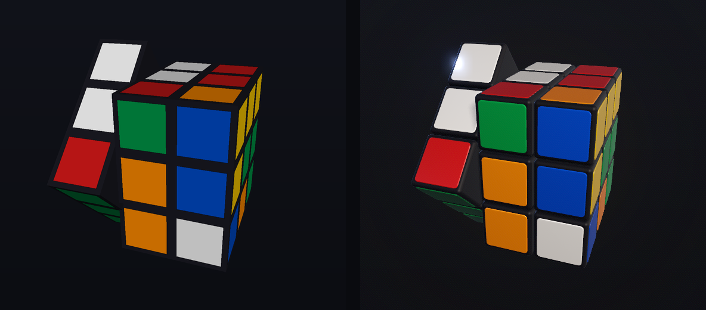
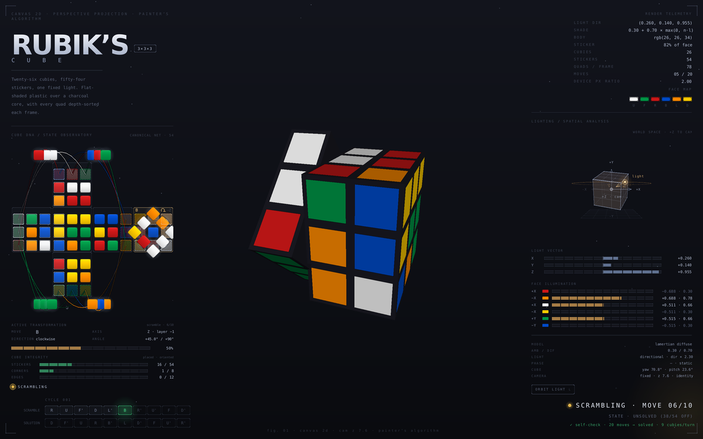
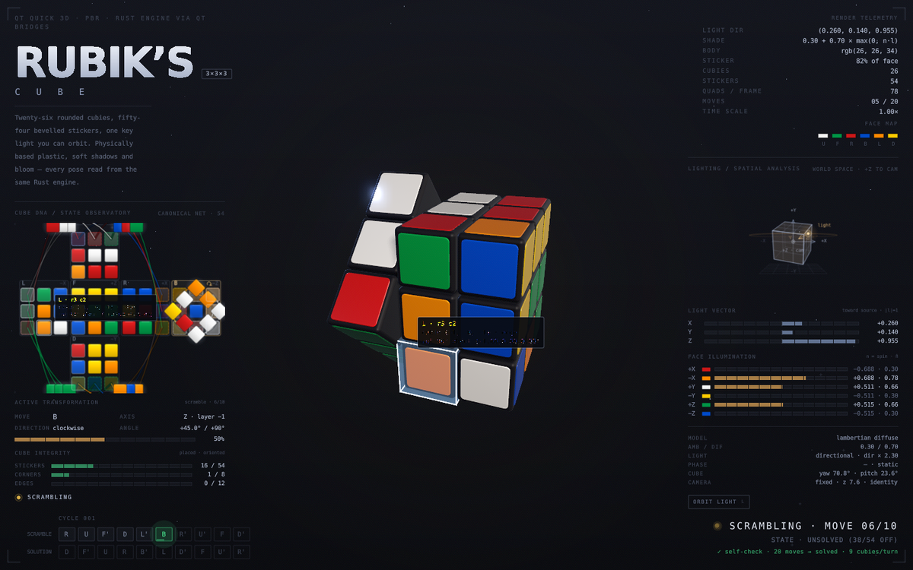
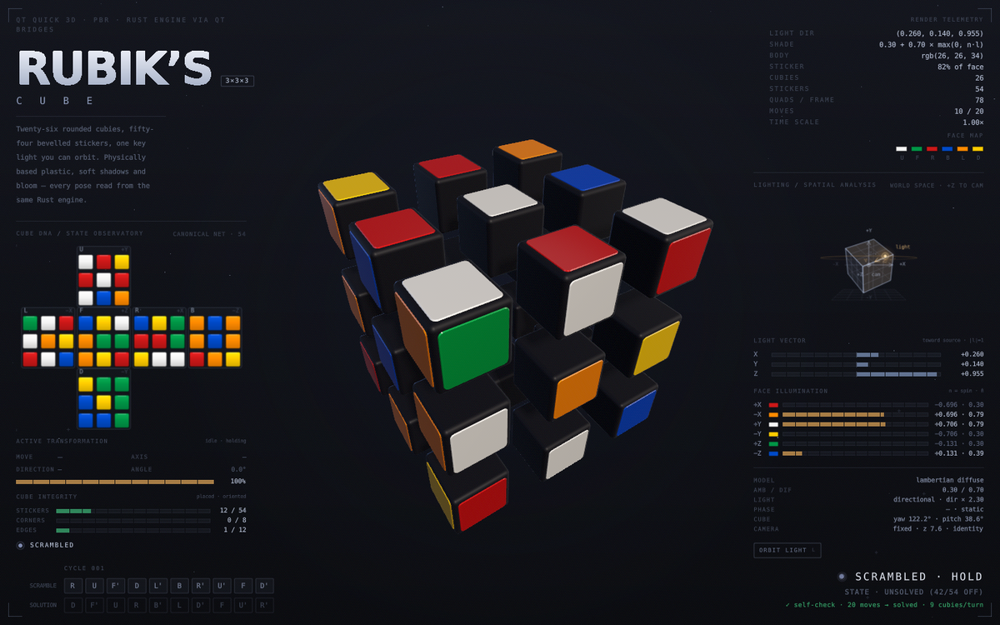
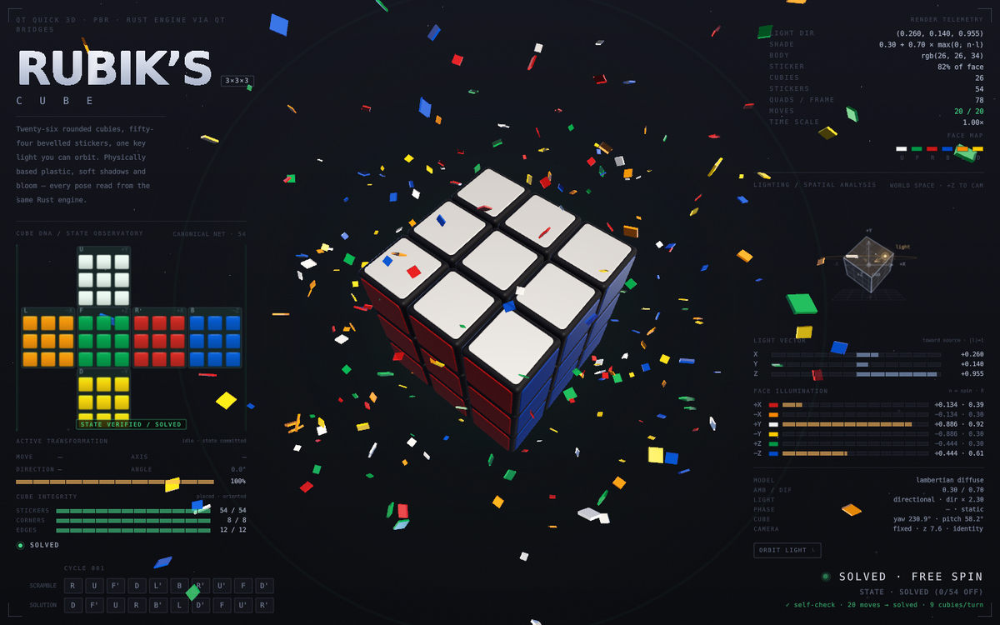
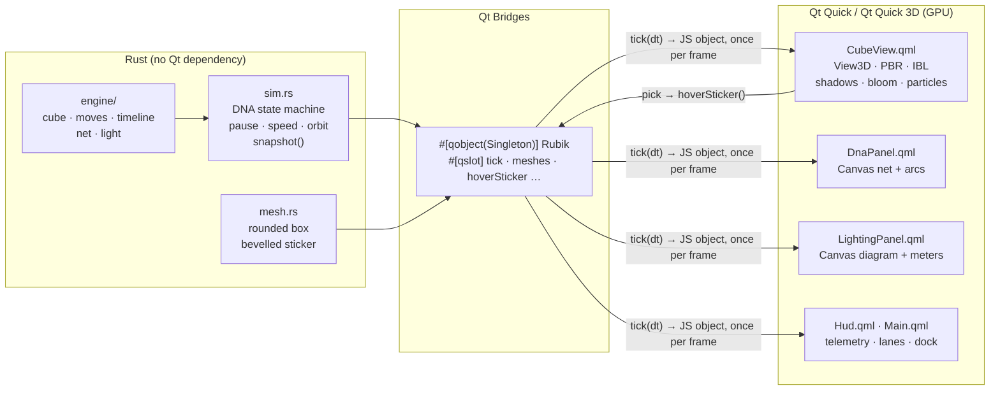

<div align="center">

# Rubik's Cube · Rust × Qt

**A Rubik's Cube "observatory" written in Rust: a hand-written software renderer was replaced with Qt Quick 3D.**

The puzzle engine is identical. The renderer is new, and so is everything you can do with it.




<sub>Live capture. The cube, the unfolded "DNA" net on the left and the lighting instrument on the right are all driven by one Rust simulation, frame by frame.</sub>

</div>

---

## Contents

- [Before → After](#before--after)
- [Why Qt? Eight things it bought this project](#why-qt-eight-things-it-bought-this-project)
- [Architecture](#architecture)
- [Features & controls](#features--controls)
- [Build & run](#build--run) · [Windows](#windows-11) · [Linux / WSL](#linux--wsl)
- [Engineering notes](#engineering-notes)
- [The full write-up →](docs/WRITEUP.md)

---

## Before → After

The first version was a native Rust port of a single-page HTML Canvas demo. It had **no
GPU and no UI toolkit**: `winit` opened a window, `softbuffer` handed it pixels, and every
pixel came from code in the repo. That meant a ~1,000-line scan-line rasteriser, a
font renderer, a CSS-like layout engine and a painter's-algorithm 3D pass. It worked, and
profiling made it fast enough, but every new visual idea meant writing more rasteriser.

The Qt version keeps the **engine unchanged** (`src/engine/`: cube state,
quarter-turn algebra, timeline, sticker-permutation net, lighting model; the only diff
is one `use` line, because `Color` moved out of the deleted graphics module). It hands
presentation to Qt Quick and Qt Quick 3D, connected to Rust through
**[Qt Bridges](https://www.qt.io/development/qt-framework/qt-bridges/rust-gui)**.

#### Same engine, same instant (t = 4.75 s, mid-turn of `B`), two renderers



<table>
<tr>
<th width="50%">Before: hand-written software renderer</th>
<th width="50%">After: Qt Quick + Qt Quick 3D</th>
</tr>
<tr>
<td></td>
<td></td>
</tr>
<tr>
<td>

- Flat quads, painter's algorithm, Lambert shading
- Supersampled 2× on the CPU for anti-aliasing
- Hand-written text, gradients, dashes and round joins
- Interaction: one key (`L`) and hovering the net

</td>
<td>

- Rounded cubies and bevelled stickers (meshes generated in Rust)
- PBR plastic, HDR image-based lighting, soft shadows, SSAO, MSAA, bloom
- Drag-to-orbit with inertia, zoom, 3D hover-picking, exploded view
- Solve celebration: 3D confetti and shockwave rings

</td>
</tr>
</table>

#### By the numbers

| | Before (`winit` + `softbuffer`) | After (Qt Quick 3D via Qt Bridges) |
|---|---|---|
| Puzzle engine | 898 lines | **the same 898 lines**: one `use` line differs |
| Presentation code<sup>1</sup> | ~4,240 lines of Rust | **~2,350 lines** (1,711 QML + Rust bridge/mesh) |
| Custom rasteriser + font engine | 1,197 lines | **0**: Qt's scene graph and text stack |
| Where pixels are made | CPU, every pixel | GPU (Direct3D 11 / Vulkan / OpenGL via Qt RHI) |
| App CPU time per frame<sup>2</sup> | ~30 ms (cube 8 · DNA 7 · HUD 4 · convert 8 · blit 4) | **~2.3 ms** (Rust tick 0.7 + QML bindings 1.6) |
| 3D | flat quads, no depth buffer | meshes, PBR, IBL, shadows, AO, bloom, particles |
| Interaction | `L` key, net hover | orbit, zoom, pick, pause, time-scale, explode, help |

<sub><sup>1</sup> Before: `gfx/` + `render/` + `ui/` + `main.rs`. After: `src/qml/` +
`sim.rs` + `mesh.rs` + `main.rs`, with tests counted on both sides. Non-blank lines.
<br><sup>2</sup> Before: the original project's own Tracy profiling on Windows (4K at
250 %). After: measured in-app (`--quit-after`) on the same laptop (RTX A5000).
The two measure different window sizes. The point is where the work lives, not a
benchmark.</sub>

| Hover any cubie: it glows and is named | Exploded view (`E`) | Verified solve |
|---|---|---|
|  |  |  |

---

## Why Qt? Eight things it bought this project

Each point links to the code that shows it.

### 1 · Rust stays Rust: Qt Bridges is a thin attribute layer

The whole Rust ↔ QML surface is one struct with attributes. No C++, no `moc`
headers to maintain, no FFI glue written by hand
([`src/main.rs#L28`](src/main.rs#L28)):

```rust
#[derive(Default)]
pub struct Rubik { sim: Sim }

#[qobject(Singleton)]
impl Rubik {
    /// Advance by `dt` seconds of wall time and return the frame snapshot.
    #[qslot]
    fn tick(&mut self, dt: f64) -> Value {          // serde_json::Value -> plain JS object
        self.sim.step(dt);
        self.sim.snapshot()
    }

    #[qslot(qml_name = "toggleOrbit")]
    fn toggle_orbit(&mut self) { /* ... */ }
}
```

```qml
import rubik_qt            // the Cargo package name *is* the QML module

FrameAnimation { onTriggered: win.f = Rubik.tick(frameTime) }
```

The simulation ([`src/sim.rs`](src/sim.rs)) has no Qt dependency at all, so 18 unit
tests run with plain `cargo test`.

### 2 · A production 3D renderer in ~30 lines of configuration

Physically based rendering, HDR image-based lighting, filmic tone mapping, SSAO, MSAA,
specular anti-aliasing and multi-level bloom are **properties**, not projects
([`src/qml/CubeView.qml#L80-L106`](src/qml/CubeView.qml#L80-L106)):

```qml
environment: ExtendedSceneEnvironment {
    tonemapMode: SceneEnvironment.TonemapModeFilmic
    lightProbe: Texture { source: "studio.hdr"; mappingMode: Texture.LightProbe }
    antialiasingMode: SceneEnvironment.MSAA
    aoEnabled: true;   aoStrength: 55
    glowEnabled: true; glowHDRMinimumValue: 1.6
    specularAAEnabled: true
}
```

In the original, the equivalent of `glowEnabled` was a pre-blurred radial sprite written
by hand, and anti-aliasing meant rendering the whole frame at twice the size and averaging
pixels down.

### 3 · Rust-generated geometry, straight to the GPU

The rounded cubie bodies and bevelled stickers are computed in Rust
([`src/mesh.rs#L72`](src/mesh.rs#L72)), with analytic normals and a winding test.
QML hands them to the GPU through `ProceduralMesh`
([`CubeView.qml#L38`](src/qml/CubeView.qml#L38)). There are no asset files to ship
or convert.

### 4 · The scene graph *is* the state: 26 nodes bound to the engine

Each cubie is a `Node` whose position and quaternion are bound to the Rust snapshot
([`CubeView.qml#L148`](src/qml/CubeView.qml#L148)). The partial slice turn is
already composed in Rust ([`sim.rs#L277`](src/sim.rs#L277)), so the 3D view, the
DNA net and the lighting panel can never disagree about the pose.

### 5 · Interaction that would have been weeks of work is a few lines

- **3D hover picking**: `View3D.pick()` returns the sticker under the mouse. Rust maps
  it to its net cell ([`CubeView.qml#L331`](src/qml/CubeView.qml#L331),
  [`main.rs#L85`](src/main.rs#L85)).
- **Exploded view** with a spring: one `NumberAnimation` with `Easing.OutElastic`
  ([`Main.qml#L188`](src/qml/Main.qml#L188)).
- **Confetti in the six sticker colours**: `ParticleSystem3D` with gravity
  ([`CubeView.qml#L246`](src/qml/CubeView.qml#L246)).
- Colour fades, hover states and the title sheen are `Behavior` and `ColorAnimation`.

### 6 · The HTML Canvas heritage ports almost line for line

The project began life as an HTML Canvas page. QML's `Canvas` uses the same Context2D
API, so the DNA net's permutation arcs, travelling tiles and halos
([`DnaPanel.qml#L128`](src/qml/DnaPanel.qml#L128)) and the lighting diagram
([`LightingPanel.qml#L48`](src/qml/LightingPanel.qml#L48)) are close transliterations
of the original drawing code. They didn't need redesigning.

### 7 · One binary, every backend, every platform

QML, fonts and the HDR environment are compiled into the executable as Qt resources
(`include_bytes_qml!`, [`main.rs#L251`](src/main.rs#L251)). Qt's RHI chooses
Direct3D 11 on Windows, Vulkan or OpenGL on Linux, and Metal on macOS. The same QML runs on
all of them, and `windeployqt` turns the build into a portable folder
([`build-windows.ps1`](build-windows.ps1)).

### 8 · Platform polish comes with the toolkit

High-DPI scaling, multi-monitor placement (`--screen N`), cursor shapes, font
fallback and the window icon all come from Qt. For the icon, it uses the `IDI_ICON1`
resource embedded by [`build.rs`](build.rs) and [`icon/rubik_qt.rc`](icon/rubik_qt.rc).
The original had to hand-roll each of these.

---

## Architecture



| Path | What lives there |
|---|---|
| [`src/engine/`](src/engine) | The puzzle: 26 cubies, exact quarter-turn algebra, scramble/solve timeline, canonical net, lighting model. **Unchanged from the original** (one import line differs). |
| [`src/sim.rs`](src/sim.rs) | The DNA panel's state machine (ported), new controls, and `snapshot()`: one JSON object per frame describing everything on screen |
| [`src/mesh.rs`](src/mesh.rs) | Procedural geometry for Qt Quick 3D |
| [`src/main.rs`](src/main.rs) | The Qt Bridges singleton, CLI, and GPU selection on Windows and WSL |
| [`src/qml/`](src/qml) | The UI: `Main`, `CubeView` (3D), `Hud`, `DnaPanel`, `LightingPanel`, `Background`, small components |
| [`tests/`](tests) | Ported self-checks of the net mapping and solve sequence |
| [`tools/make_studio_hdr.py`](tools/make_studio_hdr.py) | Generates the HDR studio light probe (standard library only) |

---

## Features & controls

| Input | Effect |
|---|---|
| **drag** / wheel / double-click | orbit the cube (with inertia) / zoom / reset view |
| **hover a cubie** | it glows, a tooltip names it (face · row · col, home slot, corner/edge/centre, twist), and its sticker is ringed in the net |
| hover a square in the **CUBE DNA** net | the same inspection, the other way round |
| `Space` | pause / resume the clock |
| `+` / `-` | time scale 0.05× – 8× |
| `E` | exploded view |
| `L` or **ORBIT LIGHT** | orbit the key light: shading, shadows and the lighting panel follow |
| `R` | reset view |
| `Q` | post-processing quality (MSAA · SSAO · soft shadows) |
| `C` | fire the solve celebration |
| `F` | fullscreen |
| `H` / `?` | help overlay |
| `Esc` | close help / quit |

Every cycle ends with a verified solve, printed as `[cube] cycle 001 after solve sequence: SOLVED`.

<details>
<summary><b>Command-line options</b></summary>

```
--width / --height <px>      window size (default 1440x900)
--screen <n>                 open on monitor n
--quality low                lighter post-processing (software GL)
--fullscreen
--shot out.png --at <secs>   render one frame at a clock reading, save it, quit
  --explode --hover <0-53> --celebrate --pointer-x/-y <px> --delay <ms>   capture helpers
--quit-after <secs>          run live, print fps + per-frame Rust/QML cost, then quit
--only-3d                    hide the 2D overlays (profiling)
```
</details>

---

## Build & run

**Requirements:** Rust ≥ 1.88 · a C++ compiler · **Qt ≥ 6.10** with `qtbase`,
`qtdeclarative`, `qtquick3d`, `qtshadertools` and `qtquicktimeline`. Qt Bridges finds Qt
through `qmake`: set `QMAKE`, or copy [`.cargo/config.toml.example`](.cargo/config.toml.example)
to `.cargo/config.toml`.

### Windows 11

You need Rust (MSVC), Visual Studio 2022 Build Tools, and Qt for MSVC 2022 x64. Then:

```powershell
powershell -ExecutionPolicy Bypass -File .\build-windows.ps1 -QtDir C:\Qt\6.12.1\msvc2022_64 -Run
```

This builds `dist\rubik_qt.exe` and bundles a portable folder with the Qt DLLs, QML
plugins and the MSVC runtime. On hybrid-graphics laptops the app selects the discrete
GPU itself. See [Engineering notes](#engineering-notes).

### Linux / WSL

```bash
export QMAKE=~/Qt/6.12.1/gcc_64/bin/qmake
cargo build --release
./target/release/rubik_qt
cargo test --release         # 18 tests: engine self-checks, meshes, simulation
```

`build.rs` bakes Qt's library path into the binary, so `LD_LIBRARY_PATH` isn't needed.

---

## Engineering notes

A few things that weren't obvious, and how they were solved:

- **Hybrid GPUs pick the wrong adapter.** Qt's D3D11 backend uses DXGI adapter 0, which on
  Optimus laptops is the integrated Intel GPU. The app enumerates the adapters and
  selects the one with the most dedicated VRAM
  ([`main.rs#L187`](src/main.rs#L187)).
- **`std::env::set_var` is invisible to Qt on Windows.** Qt reads the C runtime's copy
  of the environment, so the value is also set with `_putenv_s`
  ([`main.rs#L215`](src/main.rs#L215)).
- **WSL silently falls back to CPU rendering** (Mesa's Zink driver fails). Selecting the
  `d3d12` Gallium driver and XWayland is a 10× speed-up, applied automatically
  ([`main.rs#L150`](src/main.rs#L150)).
- **A `Repeater` fed a per-frame array rebuilds its delegates every frame.** All per-frame
  data is indexed through fixed-count models instead.
- **QML text measured in em.** CSS `letter-spacing` from the original page maps to
  `font.letterSpacing = em × px` ([`Label2.qml`](src/qml/Label2.qml)).

The [full write-up](docs/WRITEUP.md) covers the migration step by step: what moved,
what was deleted, what it cost, and what Qt made possible.

---

<div align="center">
<sub>Built with Rust, <a href="https://www.qt.io/development/qt-framework/qt-bridges/rust-gui">Qt Bridge for Rust</a> (technology preview) and Qt 6.12.</sub>
</div>
