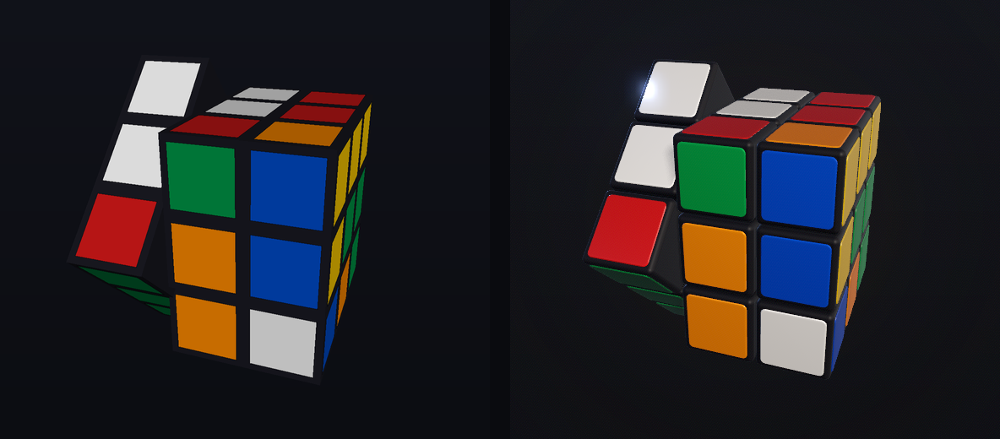
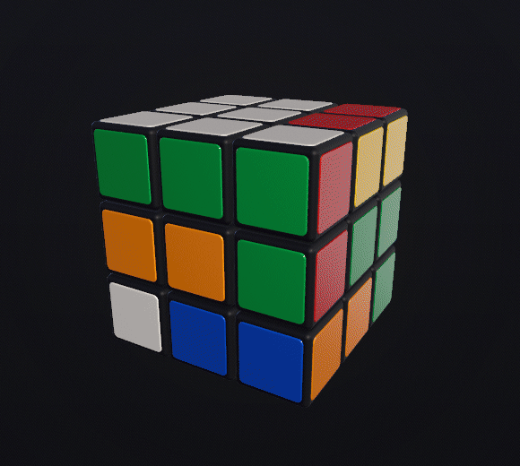
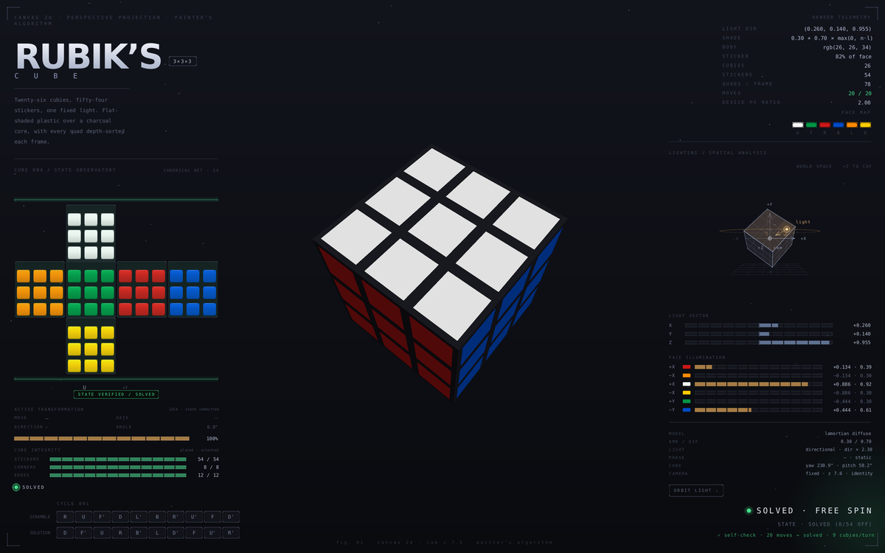
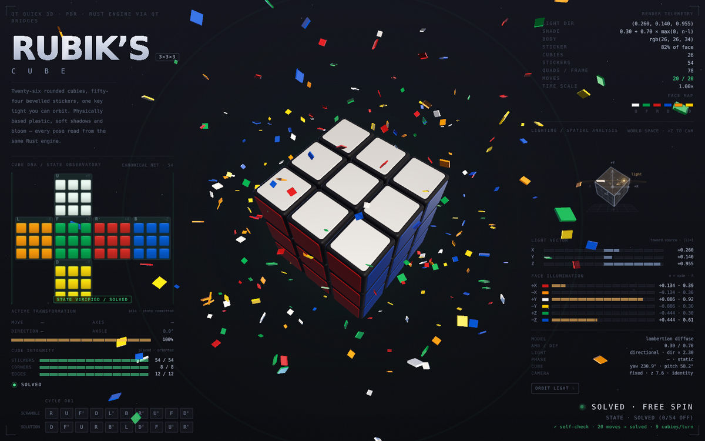
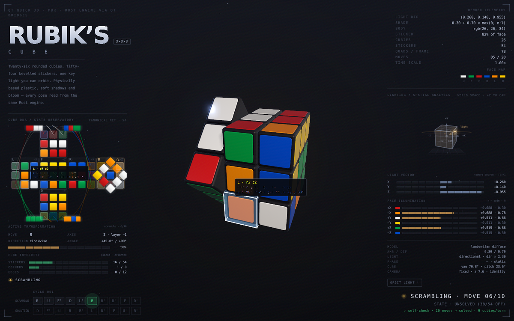
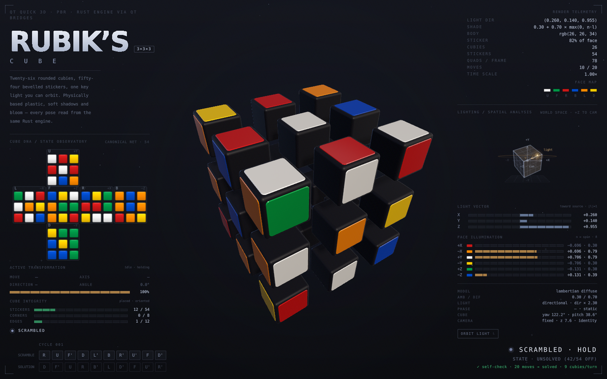

# From a hand-written rasterizer to Qt Quick 3D

*Moving a Rust application to Qt with Qt Bridges: what moved, what was deleted, what it
cost, and what it made possible.*



<sub>Same engine, same clock reading (t = 4.75 s, a quarter turn of the back face half done).
Left: the original CPU renderer. Right: the Qt version.</sub>

---

## TL;DR

- The application is a Rubik's Cube "observatory". A 3×3×3 cube scrambles and solves
  itself in a loop. Two instruments explain it: an unfolded **DNA net** showing each
  quarter turn as a permutation of 54 stickers, and a **lighting diagram** showing the
  shading model.
- Version 1 was pure Rust: `winit` for the window, `softbuffer` for pixels, and roughly
  **4,240 lines** of hand-written rasterizer, font engine, layout engine and painter's-algorithm
  3D.
- Version 2 keeps the **898-line engine unchanged** and replaces the whole presentation
  layer with **Qt Quick + Qt Quick 3D**, connected by **Qt Bridge for Rust**. The new
  presentation layer is about **2,350 lines** and adds physically based 3D, image-based
  lighting, shadows, bloom, particles, 3D picking, orbit/zoom, an exploded view and a
  help overlay.
- Application CPU time per frame fell from about **30 ms** (CPU rasterizing everything)
  to about **2.3 ms** (a Rust simulation step plus QML bindings). Pixels are now made on
  the GPU.
- The costs are real: a much larger deployment (an 86 MB folder versus one 2.7 MB
  exe), a technology-preview binding layer, a Qt 6.10+ requirement, and the loss of
  bit-identical cross-platform frames. They're covered honestly in [Costs](#7--the-costs).

---

## 1 · Where it started

Version 1 was itself a port: a single HTML page with a Canvas 2D cube, a DOM HUD and two
canvas instruments, rewritten as a native Rust program. The constraints were deliberately
strict: no browser, no GPU API, no UI toolkit.

| Layer | Version 1 implementation | Lines |
|---|---|---|
| Puzzle engine | `engine/`: cubies, quarter-turn algebra, timeline, net mapping, light | 898 |
| Rasterizer | `gfx/canvas.rs`: scan-line fill, thick lines with round joins, dashes, gradients, rounded rects, sprite blits | 990 |
| Text | `gfx/font.rs`: `ab_glyph`, CSS letter-spacing, alignment, baselines | 207 |
| Layout | `ui/layout.rs`, `ui/metrics.rs`: the page's CSS box model, resolved by hand | 564 |
| Drawing | `ui/hud.rs`, `ui/lighting.rs`, `ui/dna.rs`, `render/cube.rs` | 1,959 |
| Window loop | `main.rs` | 407 |

It was good engineering. The engine has a deterministic clock, so the pose is a pure
function of time. A headless `--png` mode produced **bit-identical** frames on Linux and
Windows. A whole profiling campaign took the Windows build from 9 to about 30 fps at 4K.

The cost showed up whenever the design changed. Anti-aliasing meant rendering at twice the
size and averaging down. A glow meant a pre-blurred sprite. Any new visual idea meant
more rasterizer code, and any new interaction meant hand-written hit testing.

## 2 · Why Qt

The goal was a much richer UI without giving up the Rust engine. The requirements:

1. **Keep the engine in Rust, untouched**, and keep it testable without a GUI.
2. **Real GPU 3D** with modern materials, plus 2D instrument panels that were already
   written against a Canvas-style API.
3. **Declarative UI** for HUD layout, states and animations, instead of hand-rolled layout.
4. **Windows and Linux** from one codebase.

Qt meets all four. Qt Quick is declarative and GPU-backed, and Qt Quick 3D is a full PBR
renderer built on the same scene graph. QML's `Canvas` uses the HTML Context2D API that
the original instruments were written in. **Qt Bridge for Rust** (crate `qtbridge`, a
technology preview) exposes Rust structs to QML with attributes rather than a C++ layer.

## 3 · The design: one bridge object, one snapshot per frame

Many fine-grained Qt properties with change signals was the obvious alternative. Instead,
the Rust side exposes **one singleton with a handful of slots**:

```rust
#[qobject(Singleton)]
impl Rubik {
    #[qslot] fn tick(&mut self, dt: f64) -> Value { self.sim.step(dt); self.sim.snapshot() }
    #[qslot] fn meshes(&self) -> Value { rubik_qt::mesh::meshes_json() }
    #[qslot(qml_name = "hoverSticker")] fn hover_sticker(&mut self, cubie: i32, slot: i32) -> i32 { … }
    // toggleOrbit, togglePause, setSpeed, orbitBy, releaseOrbit, resetView, …
}
```

QML drives the clock. A `FrameAnimation` calls `Rubik.tick(frameTime)`, and the result,
a `serde_json::Value` that QtBridge delivers as a plain JS object, becomes the single
source of truth for that frame:

```qml
FrameAnimation { onTriggered: win.f = Rubik.tick(frameTime) }
CubeView { frame: win.f }   DnaPanel { frame: win.f }   LightingPanel { frame: win.f }
```

Why this works well:

- **Atomic frames.** The 3D cube, the net and the lighting panel all read the same
  snapshot, so they can't show different moments. Version 1 had the same guarantee
  because it drew everything in one function. A snapshot keeps it.
- **Qt-free simulation.** `sim.rs` is ordinary Rust with no Qt types, so its behaviour is
  unit-tested with `cargo test`: quaternion conversion, light orientation, pause and
  time scale, the user orbit reaching the lighting panel, and picking.
- **It's cheap.** Measured: the Rust step plus conversion takes about 0.7 ms per frame,
  and applying the bindings about 1.6 ms.

The 3D view keeps the engine's semantics exactly. Each cubie's transform is
`spin × slice_turn × orientation`, as in the original renderer. The slice turn is
composed in Rust ([`sim.rs`](../src/sim.rs)) and the global spin is applied to a parent node.

## 4 · The migration, step by step

**Getting Qt.** Qt Bridges needs Qt ≥ 6.10, and Ubuntu 24.04's packages are 6.4. Qt
6.12.1 was installed from the official `download.qt.io` archives, on Linux and for
MSVC on Windows. A "hello counter" checked the toolchain before any real code was
written.

**Porting the instruments.** The DNA net and the lighting diagram became QML `Canvas`
items. Version 1's drawing calls were themselves a port of Context2D code, so the port
mostly turned Rust calls back into the JavaScript they came from: `stroke_rrect` became
`roundRect` plus `stroke`, and so on. The panel's *state machine* (in-flight permutation
plans, commit pulses, the solved flash) stayed in Rust, verbatim, in `sim.rs`.

**Building the 3D scene.**

- **Geometry.** Rust generates a rounded box for each cubie body and a bevelled,
  rounded-corner slab for each sticker ([`mesh.rs`](../src/mesh.rs)), with analytic normals
  and a unit test for triangle winding. QML passes them to `ProceduralMesh`.
- **Materials.** `PrincipledMaterial`: matte charcoal plastic, plus glossy stickers with a
  clear-coat layer.
- **Light.** The engine's light vector, the same one the lighting panel reports, drives a
  shadow-casting `DirectionalLight` through a quaternion computed in Rust. Orbit the
  light with `L` and the shading, shadows and instrument all move together.
- **Environment.** A procedural HDR "photo studio" (soft boxes, a rim strip) gives the
  stickers something to reflect. It's generated by a dependency-free Python script
  ([`tools/make_studio_hdr.py`](../tools/make_studio_hdr.py)) as Radiance RGBE.
- **Post-processing.** `ExtendedSceneEnvironment`: filmic tone mapping, SSAO, MSAA,
  specular AA and bloom, all as properties.

<p align="center"></p>

**New interaction**, each a few lines of QML on top of the engine:

| Feature | Qt mechanism | Engine involvement |
|---|---|---|
| Drag to orbit, with inertia | `MouseArea` | Rust composes the user rotation *into the engine's spin*, so the lighting panel's face table stays truthful |
| Zoom, reset | camera `z` + `Behavior` | — |
| 3D hover inspector | `View3D.pick()` | Rust maps (cubie, sticker slot) to its net cell |
| Exploded view | `NumberAnimation`, `Easing.OutElastic` | — |
| Solve celebration | `ParticleSystem3D` + 2D rings | fired by a counter that bumps on each *verified* solve |
| Pause / time scale | dock buttons + keys | `Sim::step` scales the clock |

**Keeping it verifiable.** Version 1's `--png --at <t>` mode was too useful to lose. The
Qt version has `--shot out.png --at <t>`: the same 60 Hz pre-roll, then
`grabToImage`. Every screenshot in this repository came from it, including the matched
before/after pairs, rendered by both binaries at identical clock readings.

## 5 · What went wrong (and the fixes)

| Symptom | Cause | Fix |
|---|---|---|
| `Cannot override FINAL property` | custom properties named `left` and `right` clash with `Item`'s anchor lines | rename them |
| Light probe ignored | Qt Quick 3D can't use a live `sourceItem` texture as a light probe | generate a real `.hdr` file |
| No confetti (0 particles) | particles nested in a `Repeater3D` delegate never registered with their `ParticleSystem3D` | declare particle types as direct children; set `system:` on the emitters |
| Shock "ring" rendered as an opaque disc | the alpha-blended sphere wasn't blending as intended | redraw it as two 2D rings over the view |
| Frame drops | `Repeater`s whose model was a fresh per-frame array rebuilt their delegates every frame | fixed-count models that index into the snapshot |
| 3 fps under WSL | Mesa's Zink driver fails and Qt silently falls back to llvmpipe | select `GALLIUM_DRIVER=d3d12` and XWayland automatically |
| Running on the Intel iGPU on Windows | Qt's D3D11 backend takes DXGI adapter 0 | enumerate adapters and pick the one with the most VRAM |
| …and the fix didn't apply | Qt reads the **C runtime's** copy of the environment, which `std::env::set_var` doesn't update | also call `_putenv_s` |
| Build "succeeded" but the old exe remained | the app was running and `dist\rubik_qt.exe` was locked | the script now fails loudly |
| Generic window icon | — | embed `IDI_ICON1`, which Qt uses for every window |

## 6 · Results

| | Before | After |
|---|---|---|
| Presentation code | ~4,240 lines of Rust | ~2,350 lines (1,711 QML + Rust bridge/mesh) |
| Rasterizer + font engine | 1,197 lines | none (Qt) |
| Rendering | CPU, flat quads, painter's algorithm | GPU, PBR meshes, IBL, shadows, AO, bloom, particles |
| App CPU per frame | ~30 ms | ~2.3 ms |
| Interaction | `L` key, net hover | orbit, zoom, 3D pick, pause, time scale, explode, help |
| Tests | net / canvas / hover | net self-checks + meshes + simulation (18) |

| Before: verified solve | After: verified solve |
|---|---|
|  |  |
| *t = 15.5 s in the original: the net flashes green.* | *The same moment in the Qt version: the net flash, plus 3D confetti in the six sticker colours and shockwave rings.* |

| | |
|---|---|
|  |  |
| *Hover any cubie: it glows, a tooltip names it, and its sticker is ringed in the net.* | *Exploded view: the cubies spring apart and keep turning.* |

On the development laptop (RTX A5000, three monitors) the Qt build runs at 47–60 fps
depending on which monitor, and therefore which GPU, drives the window. Each display is
wired to a different adapter, so frame pacing is decided by the compositor rather than by
the app. The app's own frame work is about 2 ms.

## 7 · The costs

A migration write-up that only lists wins isn't worth much. Here's what Qt cost:

- **Deployment size.** Version 1 was a single, statically linked 2.7 MB `.exe`. Version 2
  is a 2.9 MB exe plus an **86 MB** folder of Qt DLLs, QML plugins and the MSVC runtime
  (`windeployqt`). Trimming is possible but was not attempted.
- **A large toolchain dependency.** Qt ≥ 6.10 isn't in Ubuntu 24.04's repositories, and the
  first build compiles cxx-qt and qtbridge, which takes 2–3 minutes.
- **Technology preview.** Qt Bridge for Rust is pre-1.0. Its API may change before general availability.
- **No more bit-identical frames.** Version 1's software renderer produced identical
  pixels on every platform. GPU output depends on the driver. The `--shot` mode keeps the
  *state* deterministic, but not the pixels.
- **Licensing.** Qt and Qt Bridges are available under LGPL-3.0 or a commercial licence.
  Dynamic linking (the default here) is the usual LGPL route, but it needs to be stated
  correctly when distributing.
- **Platform gaps.** There's no window icon on Linux yet: `cxx-qt-lib` exposes no
  `QIcon`, so it would need a small C++ shim.

## 8 · Takeaways

1. **Draw the line at the engine.** Because the simulation never knew how it was drawn,
   swapping the renderer didn't touch a line of puzzle logic. The new layer is
   testable without a GUI, too.
2. **Prefer one snapshot to many signals** when a UI shows a simulation. Frames stay
   atomic and the bridge stays tiny.
3. **Let the toolkit own the pixels.** The most valuable code deleted was the rasterizer
   and font engine. The most valuable code gained was interaction that would have been
   too expensive to build by hand: picking, orbiting, particles, animation curves.
4. **Measure on the target.** The GPU-selection and environment-variable problems on
   Windows only appeared on real hardware, and only fps logging plus Qt's own
   `QSG_INFO` / `QSG_RENDER_TIMING` diagnostics made them visible.

---

<sub>Rust 1.97 · Qt 6.12.1 · qtbridge 0.4.1 · Tested on Windows 11 (D3D11, RTX A5000) and Ubuntu 24.04 / WSLg.</sub>
