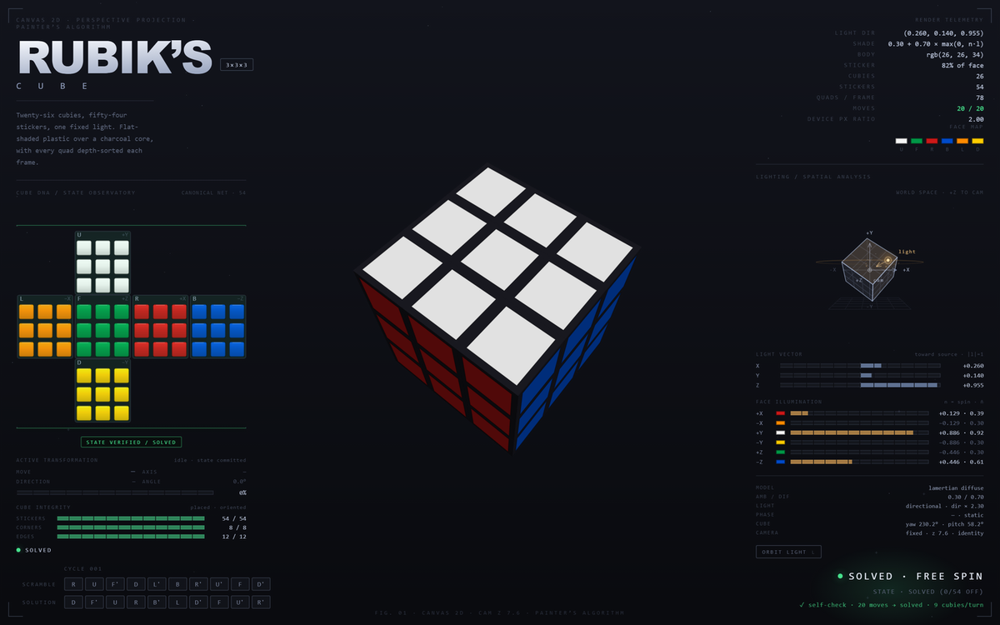

# HTML → Rust → Qt: one Rubik's Cube, three renderers

*How a single-file HTML page became a native Rust program through an AI conversion, and
then a Qt Quick 3D application through Qt Bridges. What each stage inherited, what Qt
replaced, what went wrong, and what it cost.*


<sub>The same clock reading (t = 4.75 s, the back face half way through a quarter turn),
rendered by all three stages.</sub>

---

## TL;DR

- **Stage 1** is an HTML page: one self-contained 2,994-line file. Canvas 2D draws a
  3×3×3 cube that scrambles and solves itself in a loop. A responsive DOM/CSS HUD frames
  it, and two more canvases explain it: a **lighting** instrument and a **"cube DNA"**
  net that shows each quarter turn as a permutation of 54 stickers.
- **Stage 2**: an **AI prompt converted the page to native Rust**. With no browser, the
  conversion had to rebuild what the browser provided (a Canvas 2D rasterizer, text
  rendering, CSS layout), so it came to about **4,240 lines** of presentation code
  around an **898-line** puzzle engine. It's faithful: its frames match the page almost
  pixel for pixel.
- **Stage 3**: **AI was asked to implement a Qt version** with Qt Bridges. It keeps the
  Rust engine unchanged, retires the browser-replacement layer, and hands presentation to
  **Qt Quick and Qt Quick 3D**. The new presentation layer is about **2,350 lines** and adds
  physically based 3D, image-based lighting, shadows, bloom, particles, 3D picking,
  orbit/zoom and an exploded view.
- App CPU time per frame fell from about **30 ms** (stage 2, rasterizing everything on the
  CPU) to about **2.3 ms** (stage 3: a Rust simulation step plus QML bindings). Pixels are
  now made on the GPU.
- The costs are real: an 86 MB deployment folder instead of a single 2.7 MB exe, a
  technology-preview binding layer, a Qt 6.10+ requirement, and no more bit-identical
  frames across platforms. See [§8](#8--the-costs).

---

## 1 · Stage 1: the HTML page

`rubiks-cube-DNA.html` is where the project began, and it was built up in three steps on the
same day:

| Iteration | Lines | Added |
|---|---|---|
| `rubiks-cube.html` | 970 | the cube: Canvas 2D, perspective projection, painter's algorithm, Lambert shading, the scramble/solve timeline, the corner HUD |
| `rubiks-cube-v2-lighting.html` | 1,708 | the **lighting / spatial analysis** rail: a world-space diagram of the light, the reference cube and the face-illumination table |
| `rubiks-cube-DNA.html` | 2,994 | the **cube DNA / state observatory** rail: the 54-sticker net, permutation arcs for every turn, travelling tiles, integrity meters, hover inspection |

The page is a careful piece of work. The cube's pose is a pure function of a monotonic
clock. Stickers live in cubie-local space, so colours are carried by the pieces rather than
repainted. The net is read from the cube's state rather than kept as a second copy.
`verifySequence()` checks at load that the solve really inverts the scramble,
`selfTest()` is exposed through a `window.DNA_DEBUG` hook for validation runs, and each
solve logs
`[cube] cycle 001 after solve sequence: SOLVED`. The browser does the rest: Canvas 2D
paths, gradients, `shadowBlur` and dashes; CSS custom properties and a dozen media queries
for the HUD; fonts, high-DPI and compositing.

## 2 · Stage 2: the AI conversion to Rust

An AI prompt converted the page to a native Rust program. The constraints were strict: no
browser, no GPU API, no UI toolkit. `winit` opens a window and `softbuffer` hands it pixels.

So everything the page took from the browser had to be rebuilt:

| What the browser provided | What the conversion built in Rust | Lines |
|---|---|---|
| — (the page's JavaScript logic) | `engine/`: cubies, quarter-turn algebra, timeline, net mapping, light | 898 |
| Canvas 2D | `gfx/canvas.rs`: scan-line fill, thick lines with round joins, dashes, gradients, rounded rects, sprite blits | 990 |
| text rendering | `gfx/font.rs`: `ab_glyph`, CSS letter-spacing, alignment, baselines | 207 |
| CSS layout and media queries | `ui/layout.rs`, `ui/metrics.rs`: the page's box model, resolved by hand | 564 |
| the DOM HUD + canvas drawing | `ui/hud.rs`, `ui/lighting.rs`, `ui/dna.rs`, `render/cube.rs` | 1,959 |
| the event loop | `main.rs` | 407 |

The result is impressively faithful. Its `--png --at <t>` mode renders frames that line up
with the page's (see the comparison above), and they are **bit-identical** between Linux
and Windows. A profiling pass took the Windows build from 9 fps to about 30 fps at 4K.

But the conversion also shows the cost of leaving the browser. Anti-aliasing became
"render at twice the size and average down". `shadowBlur` became a pre-blurred sprite.
Every new visual idea would need more rasterizer, and every new interaction its own hit
testing.

## 3 · Stage 3: why Qt

The goal for the next step was a much richer UI without giving up the Rust code. The
requirements:

1. **Keep the engine in Rust, untouched**, and keep it testable without a GUI.
2. **Get the browser's services back natively**: text, layout, styling, animation.
3. **Real GPU 3D** with modern materials, plus 2D instrument panels whose drawing code was
   written for a Canvas-style API.
4. **Windows and Linux** from one codebase.

Qt meets all four. Qt Quick is declarative and GPU-backed, much as the DOM/CSS layer was.
Qt Quick 3D is a full PBR renderer on the same scene graph. QML's `Canvas` speaks the
HTML Context2D API that the instruments were originally written in. **Qt Bridge for
Rust** (crate `qtbridge`, a technology preview, used here following Qt's own
tutorial) exposes Rust structs to QML with attributes instead of a C++ layer.

## 4 · The design: one bridge object, one snapshot per frame

The obvious alternative was many fine-grained Qt properties with change signals. Instead,
the Rust side exposes **one singleton with a handful of slots**:

```rust
#[qobject(Singleton)]
impl Rubik {
    #[qslot] fn tick(&mut self, dt: f64) -> Value { self.sim.step(dt); self.sim.snapshot() }
    #[qslot] fn meshes(&self) -> Value { rubik_qt::mesh::meshes_json() }
    #[qslot(qml_name = "hoverSticker")] fn hover_sticker(&mut self, cubie: i32, slot: i32) -> i32 { … }
    // toggleOrbit, togglePause, setSpeed, orbitBy, releaseOrbit, resetView, …
}
```

QML drives the clock, as `requestAnimationFrame` did in the page. A `FrameAnimation`
calls `Rubik.tick(frameTime)`, and the result, a `serde_json::Value` that QtBridge delivers
as a plain JS object, becomes the single source of truth for that frame:

```qml
FrameAnimation { onTriggered: win.f = Rubik.tick(frameTime) }
CubeView { frame: win.f }   DnaPanel { frame: win.f }   LightingPanel { frame: win.f }
```

Why this works well:

- **Atomic frames.** The 3D cube, the net and the lighting panel all read the same
  snapshot, so they can't show different moments. The page got this by drawing everything
  from one `frame()` function. The snapshot keeps that property across the language
  boundary.
- **Qt-free simulation.** `sim.rs` is ordinary Rust, unit-tested with `cargo test`:
  quaternion conversion, light orientation, pause and time scale, the user orbit reaching
  the lighting panel, and 3D picking.
- **It's cheap.** Measured: the Rust step plus conversion takes about 0.7 ms per frame, and
  applying the bindings about 1.6 ms.

The 3D view keeps the engine's semantics exactly. Each cubie's transform is
`spin × slice_turn × orientation`, as in the page's own renderer. The slice turn is
composed in Rust ([`sim.rs`](../src/sim.rs)) and the global spin is applied to a parent node.

## 5 · The Qt implementation, step by step

**Getting Qt.** Qt Bridges needs Qt ≥ 6.10, and Ubuntu 24.04's packages are 6.4. Qt 6.12.1
was installed from the official `download.qt.io` archives, on Linux and for MSVC on
Windows. A "hello counter" proved the toolchain before any real code was written.

**The instruments went home to Context2D.** The DNA net and the lighting diagram became QML
`Canvas` items, back on `arc`, `arcTo`, `setLineDash` and `createRadialGradient`: the same
calls the HTML page used. In stage 2 each of those calls had needed its own rasterizer
routine. The panel's *state machine* (in-flight permutation plans, commit pulses, the
solved flash) stayed in Rust, in `sim.rs`.

**The HUD went back to declarative layout.** The corner blocks (wordmark, telemetry, move
lanes, status) are QML items with anchors, much like the page's CSS-positioned panels.
The page's `letter-spacing` in em maps to `font.letterSpacing = em × px`, and its CSS
transitions became `Behavior` and `ColorAnimation`.

**Building the 3D scene.**

- **Geometry.** Rust generates a rounded box for each cubie body and a bevelled,
  rounded-corner slab for each sticker ([`mesh.rs`](../src/mesh.rs)), with analytic normals
  and a unit test for triangle winding. QML passes them to `ProceduralMesh`.
- **Materials.** `PrincipledMaterial`: matte charcoal plastic, plus glossy stickers with a
  clear-coat layer.
- **Light.** The engine's light vector, the same one the lighting panel reports, drives a
  shadow-casting `DirectionalLight`. Orbit it with `L` and the shading, shadows and
  instrument move together.
- **Environment.** A procedural HDR "photo studio" gives the stickers something to reflect.
  It's generated by a dependency-free Python script
  ([`tools/make_studio_hdr.py`](../tools/make_studio_hdr.py)).
- **Post-processing.** `ExtendedSceneEnvironment`: filmic tone mapping, SSAO, MSAA,
  specular AA and bloom, all as properties.

<p align="center"></p>

**New interaction**, each a few lines of QML on top of the engine:

| Feature | Qt mechanism | Engine involvement |
|---|---|---|
| Drag to orbit, with inertia | `MouseArea` | Rust composes the user rotation *into the engine's spin*, so the lighting panel's face table stays truthful |
| Zoom, reset | camera `z` + `Behavior` | — |
| 3D hover inspector | `View3D.pick()` | Rust maps (cubie, sticker slot) to its net cell |
| Exploded view | `NumberAnimation`, `Easing.OutElastic` | — |
| Solve celebration | `ParticleSystem3D` + 2D rings | fired by a counter that bumps on each *verified* solve |
| Pause / time scale | dock buttons + keys | `Sim::step` scales the clock |

**Keeping it verifiable.** All three stages can render an exact instant: the Rust
conversion with `--png --at`, the Qt version with `--shot --at` (the same 60 Hz pre-roll,
then `grabToImage`), and the HTML page in a headless browser, with the same pre-roll
injected into a scratch copy. Every comparison image in this repository came from those
modes, at identical clock readings.

## 6 · What went wrong (and the fixes)

| Symptom | Cause | Fix |
|---|---|---|
| `Cannot override FINAL property` | custom properties named `left` and `right` clash with `Item`'s anchor lines | rename them |
| Light probe ignored | Qt Quick 3D can't use a live `sourceItem` texture as a light probe | generate a real `.hdr` file |
| No confetti (0 particles) | particles nested in a `Repeater3D` delegate never registered with their `ParticleSystem3D` | declare particle types as direct children; set `system:` on the emitters |
| Shock "ring" rendered as an opaque disc | the alpha-blended sphere wasn't blending as intended | redraw it as two 2D rings over the view |
| Frame drops | `Repeater`s whose model was a fresh per-frame array rebuilt their delegates every frame | fixed-count models that index into the snapshot |
| 3 fps under WSL | Mesa's Zink driver fails and Qt silently falls back to llvmpipe | select `GALLIUM_DRIVER=d3d12` and XWayland automatically |
| Running on the Intel iGPU on Windows | Qt's D3D11 backend takes DXGI adapter 0 | enumerate adapters and pick the one with the most VRAM |
| …and the fix didn't apply | Qt reads the **C runtime's** copy of the environment, which `std::env::set_var` doesn't update | also call `_putenv_s` |
| Hovering the 3D cube did nothing | only the net was hoverable, and the help text said "hover net" | `View3D.pick()` hover on the cube itself, plus clearer help |
| Build "succeeded" but the old exe remained | the app was running and `dist\rubik_qt.exe` was locked | the script now fails loudly |
| Generic window icon | — | embed `IDI_ICON1`, which Qt uses for every window |

## 7 · Results

| | 1 · HTML | 2 · Rust conversion | 3 · Rust + Qt |
|---|---|---|---|
| Code | 2,994 lines, one file | 898 engine + ~4,240 presentation | 898 engine + ~2,350 presentation |
| Rendering | browser Canvas 2D, flat quads | CPU rasterizer, flat quads | GPU, PBR meshes, IBL, shadows, AO, bloom, particles |
| App CPU per frame | — | ~30 ms | ~2.3 ms |
| Interaction | `L`, net hover | `L`, net hover | orbit, zoom, 3D pick, pause, time scale, explode, help |
| Ships as | one `.html` file | one 2.7 MB `.exe` | 2.9 MB `.exe` + 86 MB Qt folder |

| 1 · HTML, verified solve | 2 · Rust, verified solve | 3 · Qt, verified solve |
|---|---|---|
|  |  |  |
| *t = 15.5 s: the net flashes green.* | *The same moment, the same flash.* | *The same flash, plus 3D confetti in the six sticker colours and shockwave rings.* |

| | |
|---|---|
|  |  |
| *Hover any cubie: it glows, a tooltip names it, and its sticker is ringed in the net.* | *Exploded view: the cubies spring apart and keep turning.* |

On the development laptop (RTX A5000, three monitors) the Qt build runs at 47–60 fps
depending on which monitor, and therefore which GPU, drives the window. The app's own
frame work is about 2 ms.

## 8 · The costs

A write-up that only lists wins isn't worth much. Here's what Qt cost:

- **Deployment size.** Stage 1 is one HTML file and stage 2 a single 2.7 MB `.exe`.
  Stage 3 is a 2.9 MB exe plus an **86 MB** folder of Qt DLLs, QML plugins and the MSVC
  runtime (`windeployqt`). Trimming is possible but was not attempted.
- **A large toolchain dependency.** Qt ≥ 6.10 isn't in Ubuntu 24.04's repositories, and the
  first build compiles cxx-qt and qtbridge, which takes 2–3 minutes.
- **Technology preview.** Qt Bridge for Rust is pre-1.0. Its API may change before general availability.
- **No more bit-identical frames.** Stage 2's software renderer produced identical pixels on
  every platform. GPU output depends on the driver. The `--shot` mode keeps the *state*
  deterministic, but not the pixels.
- **Licensing.** Qt and Qt Bridges are available under LGPL-3.0 or a commercial licence.
  Dynamic linking (the default here) is the usual LGPL route, but it needs to be stated
  correctly when distributing.
- **Platform gaps.** There's no window icon on Linux yet: `cxx-qt-lib` exposes no `QIcon`,
  so it would need a small C++ shim.

## 9 · Takeaways

1. **A good engine survives every port.** The page's design (a pure clock, state carried
   by the pieces, a net read from state) made it through a language change and a renderer
   change. The 898-line engine went from stage 2 to stage 3 untouched.
2. **Leaving the browser is expensive; a toolkit brings it back.** Most of stage 2's code
   reproduced browser services. Qt replaced that layer with less code, and with a GPU 3D
   engine on top.
3. **Prefer one snapshot to many signals** when a UI shows a simulation. Frames stay atomic
   and the bridge stays tiny.
4. **AI-assisted porting works best with a way to check the result.** Being able to render
   any exact instant in every stage made each port verifiable by eye, side by side.
5. **Measure on the target.** The Windows GPU-selection and environment-variable problems
   only appeared on real hardware, and only fps logging plus Qt's `QSG_INFO` and
   `QSG_RENDER_TIMING` diagnostics made them visible.

---

<sub>Rust 1.97 · Qt 6.12.1 · qtbridge 0.4.1 · Tested on Windows 11 (D3D11, RTX A5000) and Ubuntu 24.04 / WSLg.</sub>
